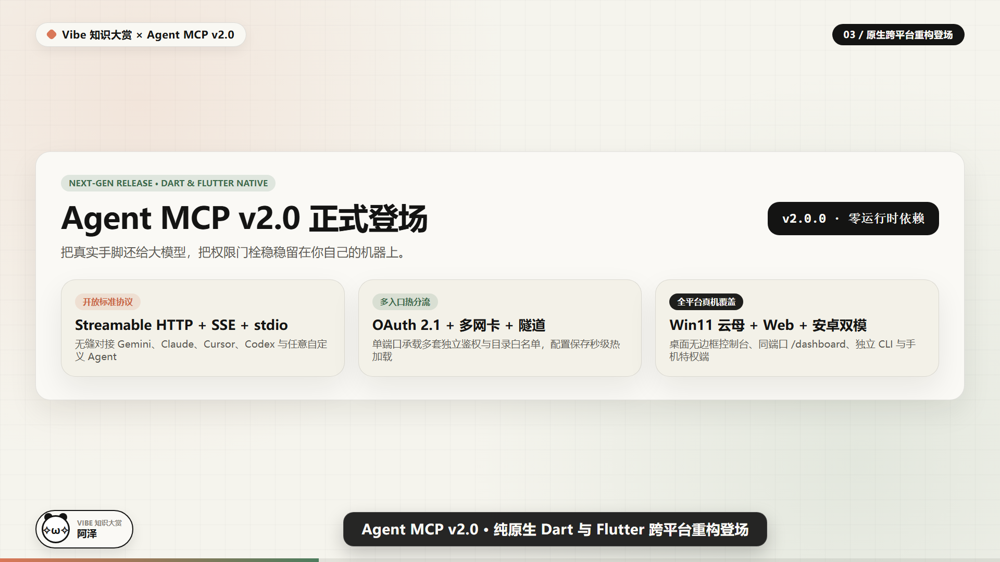
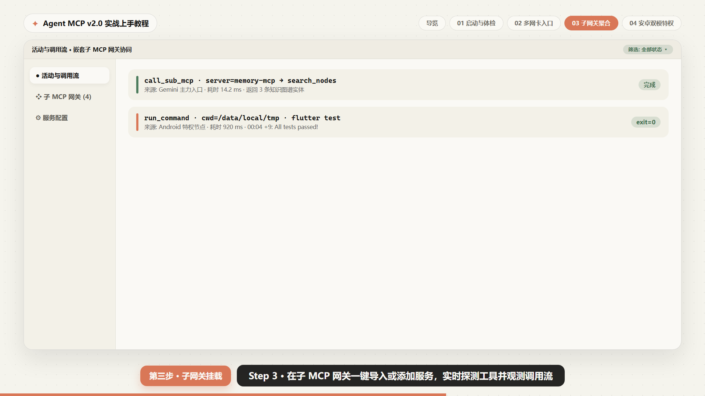
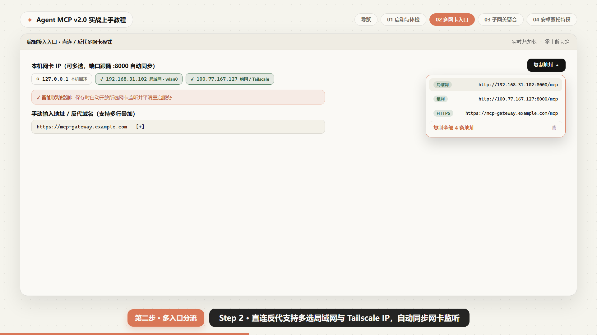
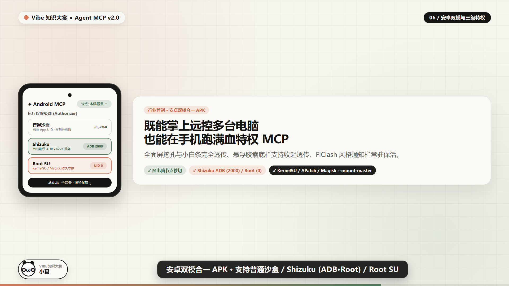

# Agent MCP v2.0

[中文](README.md) | English

[](https://github.com/iamr0s/agent-mcp/releases)
[](https://flutter.dev/)
[](https://modelcontextprotocol.io/)
[](#downloads--installation)
[](LICENSE)

> A native cross-platform **Agent MCP host, progressive Sub-MCP gateway, and multi-surface console**—letting cloud and local models step past the sandbox glass wall to inspect, edit, and drive real workspaces and mobile devices within explicit boundaries.
>
> **v2.0 Next-Gen Rewrite**: Built natively with **Dart & Flutter** with zero Python/Node runtime requirements—powering a **Win11 DWM Mica Frameless Desktop Console**, an **Android Dual-Mode Edition (`Sandbox / Shizuku / Root SU`)**, a **same-port encrypted `/dashboard` Web UI**, and a **Standalone Native CLI** from one codebase.

<p align="center">
  
</p>

## Why This Exists

Models grow sharper every quarter, yet most of the time they remain advisers locked behind bulletproof glass: capable of reasoning through hundreds of lines of code while unable to touch a single file on your disk; fluent at diagnosing a broken build while reducing you to a human clipboard ferrying logs between browser tabs and terminals.

And when you wire a dozen external MCP servers into a client, hundreds of verbose JSON schemas flood turn one—burning context window budget before any real work begins.

Agent MCP gives models real hands while keeping the bolt on your desk: open **Model Context Protocol (MCP)** transports (`Streamable HTTP`, `SSE`, `stdio`), surgical atomic edits with single-step undo, **3 compact meta-tools** fronting your entire Sub-MCP ecosystem, multi-NIC & Cloudflare Tunnel routing with self-hosted **OAuth 2.1 (RFC 7591 + PKCE)**, and an **Android Dual-Mode APK** that both manages remote PCs and runs a local privileged MCP server via **Shizuku** or **Root SU**.

> “I can only show you the door. You're the one that has to walk through it.”
>
> — Morpheus, *The Matrix*

## Visual Previews

<table>
  <tr>
    <td width="50%">
      
      <p align="center"><sub><b>Live Capsule Telemetry & Progressive Sub-MCP Gateway</b></sub></p>
    </td>
    <td width="50%">
      
      <p align="center"><sub><b>Multi-NIC / Tailscale Picker & Floating Endpoint Copy Menu</b></sub></p>
    </td>
  </tr>
  <tr>
    <td colspan="2">
      <p align="center">
        
      </p>
      <p align="center"><sub><b>Android Dual-Mode Edition: Multi-Host Remote Controller + Local Shizuku (ADB/Root) & Root SU Engine</b></sub></p>
    </td>
  </tr>
</table>

## Downloads & Installation

Grab the latest prebuilt binaries from [**GitHub Releases**](https://github.com/iamr0s/agent-mcp/releases):

- **Windows 10/11 (`x64`)**: `AgentMCP-v2.0.0-windows-x64-sfx.exe` (self-extracting GUI wizard) or `AgentMCP-v2.0.0-windows-x64-portable.zip` (zero-install portable archive containing both `agent_mcp_app.exe` and `agent-mcp.exe`).
- **Android (`arm64-v8a` / Universal)**: `AgentMCP-v2.0.0-android-arm64-v8a.apk` (recommended for modern phones) or `AgentMCP-v2.0.0-android-universal.apk`.

## Standalone CLI Quickstart

```bash
agent-mcp doctor                  # Full health, NIC/Tailscale IP & profile diagnostics
agent-mcp snippet                 # Generate Claude / Cursor / Gemini / Codex config snippets
agent-mcp gui --silent            # Launch native Win11 Mica console into system tray
agent-mcp run -t stdio            # Run as zero-latency local stdio server
agent-mcp tools                   # List all 19 built-in surgical & gateway tools
agent-mcp profile list            # Inspect multi-NIC & tunnel profiles
```

## Donation

If this project helps your workflow, optional donations are appreciated:

<p align="center">
  
  
  
</p>

## License

GNU General Public License v3.0. See [LICENSE](LICENSE) for details.