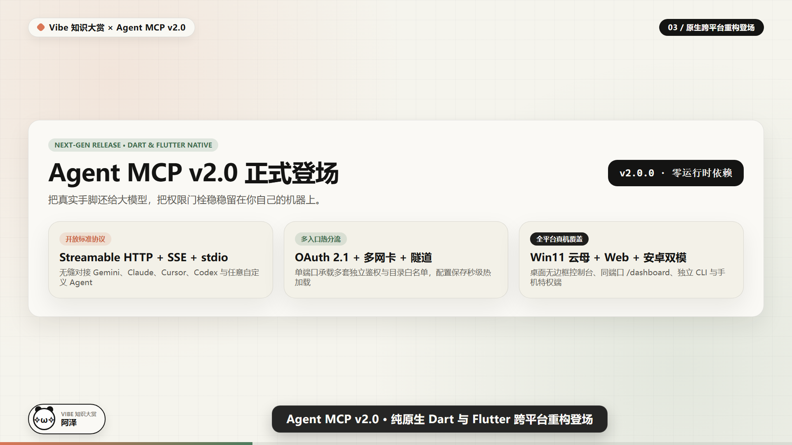
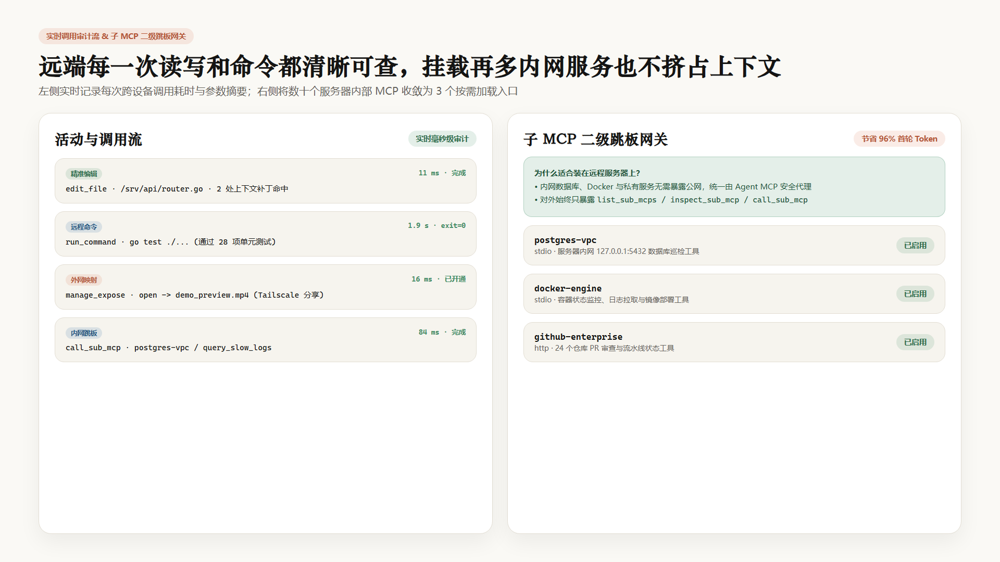
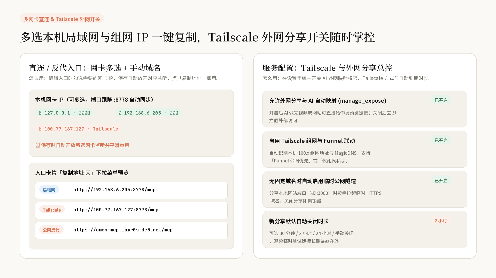
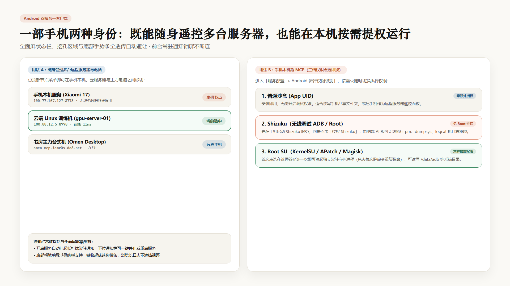

# Agent MCP v2.3

[中文](README.md) | [English](README.en.md)

[](https://github.com/iamr0s/agent-mcp/releases)
[](https://flutter.dev/)
[](https://modelcontextprotocol.io/)
[](#快速下载与安装)
[](LICENSE)

> **装在服务器、远端工作站与安卓真机上的原生 MCP 执行节点，供任意电脑端 AI 或你自己的程序跨网调用。**
>
> 眼前的开发电脑早已不缺本地编程助手；但当你的代码、算力、容器或测试环境位于**远端 Linux 云服务器、内网 GPU 主机、NAS 或手头的 Android 手机**上时，本地 `stdio` 工具便触碰到了物理边界。
>
> **Agent MCP v2.3** 基于原生 **Dart & Flutter** 构建，**零 Python / Node.js 运行时依赖**，单文件解压即跑。把它部署到任意服务器、主机或手机上，你的主力电脑（Claude、Cursor、Gemini Web、Codex、Antigravity）以及**自研 Python / TypeScript Agent 程序**即可通过标准 **Streamable HTTP (`/mcp`)** 远程读写补丁、守护长任务、经跳板调用内网子服务，还能**把远端刚生成的视频或网站端口一键映射成外部预览链接**。

<p align="center">
  
</p>

## 为什么选择 Agent MCP？（典型跨设备场景）

| 常见痛点场景 | 传统做法的局限 | Agent MCP v2.3 的解决方式 |
| :--- | :--- | :--- |
| **电脑端 AI 调试远端 Linux 云服务器 / GPU 机** | 需在服务器配复杂 Python/Node 环境，或靠粗粒度 SSH 命令整文件覆盖，内网数据库不敢开公网 | 单文件解压 + `agent-mcp init` 10 秒上线（自带 `/dashboard/` 网页管理台与 `systemd` 守护），支持行级精准补丁、`undo_edit` 秒撤回与后台进程托管 |
| **自研 Python / TS Agent 程序调度多台机器** | 需自己封装一套私有 RPC 接口、鉴权、命令超时回收与文件编码处理 | 原生兼容官方 MCP SDK（`streamablehttp_client` / `StreamableHTTPClientTransport`），几行代码即可安全调用远端主机与手机上的 20 项标准工具 |
| **电脑端无线抓 Android 真机日志与系统排障** | 依赖 USB 数据线或频繁断连的无线 ADB 桥接，切后台易掉线 | 手机直装双模 APK，支持**普通沙盒 / Shizuku / Root SU 常驻守护**三档切换与前台通知锁屏保活；同一应用还能反过来随身遥控多台远程服务器 |
| **远端服务器刚做好视频或跑起 `:3000` 网页想预览** | 得手动配 Nginx 反代、开防火墙端口，或把几百 MB 文件拉回本地 | AI 直接调用 `manage_expose` 联动 **Tailscale Funnel / 组网**或临时隧道生成外部预览链接（视频支持拖动进度条），看完在「外网与分享」页一键关闭 |

## 60 秒跨设备快速上手

### 1. 部署在远程 Linux 服务器 / GPU 机 / NAS（10 秒上线）

无需安装 Python、Node 或 Docker，下载解压即可同时获得原生服务端与可视化 Web 管理面板：

```bash
# 1. 下载并解压（内置 agent-mcp 单文件与 web_dashboard 网页前端）
curl -L https://github.com/iamr0s/agent-mcp/releases/download/v2.4.2/AgentMCP-v2.4.2-linux-x64-cli.tar.gz | tar -xzf -

# 2. 一行初始化：监听全网卡、自动识别局域网与 Tailscale IP、生成高强 Bearer Key
./agent-mcp init --name gpu-server-01 --host 0.0.0.0 -p 8778 --auth bearer --generate-key

# 3. 注册 Linux systemd 后台常驻守护（退出 SSH 或重启服务器自动拉起）
./agent-mcp service install
```

部署完成后，浏览器打开终端输出的 `http://<服务器IP>:8778/dashboard/` 即可进入图形化控制台。

### 2. 在你的电脑端 AI 或自有程序中远程调用

运行 `./agent-mcp snippet` 可直接生成各客户端与 SDK 的即拷即用代码：

**方式 A：主力电脑 Cursor / Claude Code / Windsurf / Antigravity 挂载远端服务器或手机**

```json
{
  "mcpServers": {
    "gpu-server-01": {
      "url": "http://100.88.12.5:8778/mcp",
      "headers": {
        "Authorization": "Bearer sk-mcp-你的密钥"
      }
    }
  }
}
```

**方式 B：使用官方 Python MCP SDK 在你自己的程序里远程调用（`pip install mcp`）**

```python
import asyncio
from mcp import ClientSession
from mcp.client.streamable_http import streamablehttp_client

async def main():
    url = "http://100.88.12.5:8778/mcp"  # 可填远端 Linux 服务器、Windows 主机或 Android 手机地址
    headers = {"Authorization": "Bearer sk-mcp-你的密钥"}

    async with streamablehttp_client(url, headers=headers) as (read, write, _):
        async with ClientSession(read, write) as session:
            await session.initialize()
            # 远程执行命令、改代码、查内网子服务或生成外网预览链接
            res = await session.call_tool("run_command", {"command": "nvidia-smi -L"})
            print(res.content[0].text)

asyncio.run(main())
```

**方式 C：命令行一键连通测试与直调**

```bash
# 探测远端服务器或手机节点的系统类型、工具数与网络延迟
agent-mcp remote http://100.88.12.5:8778 ping

# 直接在终端调用远端节点上的任意工具
agent-mcp remote http://100.88.12.5:8778 call list_roots '{}' -k sk-mcp-你的密钥
```

## 界面与核心能力预览

<table>
  <tr>
    <td width="50%">
      
      <p align="center"><sub><b>远端实时调用流 & 子 MCP 内网二级跳板网关</b></sub></p>
    </td>
    <td width="50%">
      
      <p align="center"><sub><b>多网卡直连多选 & Tailscale 外网分享总控</b></sub></p>
    </td>
  </tr>
  <tr>
    <td colspan="2">
      <p align="center">
        
      </p>
      <p align="center"><sub><b>Android 双模客户端：随身遥控多台服务器 + 手机本机普通沙盒 / Shizuku / Root SU 一键切换</b></sub></p>
    </td>
  </tr>
</table>

## 五大核心设计详解

### 1. 外网映射与链接分享（`manage_expose` + 独立「外网与分享」页）
远端服务器或主力机刚渲染完一段视频、生成了静态网页报告，或者在 `:3000` 跑起了前端服务，想立刻在手机或外部浏览器打开验收？
- **AI 自动发链接**：直接对 AI 说 *“把刚做好的视频映射出来发我链接看，看完关掉”*，AI 调用 `manage_expose` 即可返回外部可直开的预览地址（MP4 视频内置播放器并支持 HTTP `206 Range` 任意拖动进度条）。
- **四种清晰分享形态（`mode: file | folder | site | port`）**：
  1. **单个文件分享 (`file`)**：打开即进入干净的单文件预览页（视频支持 HTTP `206 Range` 拖动进度条，音频、图片、PDF 与代码支持在线直看，安装包直达下载）。
  2. **文件夹目录分享 (`folder`)**：打开展示清爽云盘目录与面包屑，支持进入任意子目录与 `?zip=1` 64KB 零内存堆积流式打包下载；**点击子目录内任意文件即进入单文件预览页，顶部提供可点击层级面包屑、返回所在子目录与「上一文件 / 下一文件」快捷切换（支持键盘 `←` / `→`）**。
  3. **静态网站 / HTML 分享 (`site`)**：无论传入**单个 `.html` 文件**还是**含 `index.html` 的前端构建目录**，打开都直接全屏作为真实网页运行，并拦截软链接逃逸与敏感凭据路径。
  4. **全双工端口转发分享 (`port`)**：把本机正在运行的 `:3000` / `:5173` / `:7860` 等端口一键反向代理为外部预览链接，**原生支持 `Upgrade: websocket` 全双工升级转发（完整兼容 Vite / Next.js HMR 热更新、Gradio 与 Jupyter）**。
- **拖拽直享、可选提取码与限次即焚**：桌面端与网页端支持把任意文件、文件夹或 `.html` 直接拖入窗口自动识别模式；可按需设置 **4–8 位访问提取码（PIN）** 与 **最大下载次数（如 1 次即焚自动收起）**。
- **独立管理页统一掌控**：切到 **「外网与分享」** 标签页，可点选四态快捷卡片、调用系统原生选文件/选文件夹对话框、生成手机扫码二维码、复制多通道地址或点击 **「全部关闭」** 一键收回。
- **设置页 Tailscale 总开关**：在 **「服务配置 → Tailscale 与外网分享设置」** 中，随时一键总控 AI 映射权限、切换公网或组网私享模式，并设置默认自动到期时间（30 分钟 / 2 小时 / 24 小时 / 手动关闭）。

### 2. 服务器内网子 MCP 二级跳板网关（省去 96% 首轮上下文）
在远端云服务器里跑着 PostgreSQL、Redis、Docker 或企业内部接口，既不想把数据库端口暴露到公网，也不想往客户端一次性塞进上百个工具拖慢响应？
- **怎么用**：打开远端节点的 **「子 MCP 网关」** 页，把现有的 `mcpServers` JSON 直接粘贴导入。Agent MCP 对外始终只暴露 `list_sub_mcps`、`inspect_sub_mcp`、`call_sub_mcp` **3 个固定入口**，底层内置 **热驻留进程池（`_WarmStdioSessionPool`，5 分钟空闲自动回收 + 请求多路复用）**，将连续调用延迟从冷启动秒级压至毫秒级，增删改免重启即时生效。

### 3. 多网卡直连多选与分入口权限隔离
同一台服务器或电脑既想走 Tailscale `100.x` 私网给 Cursor 连，又想走局域网给手机连，还要开一条只读公网隧道给网页端大模型看代码？
- **多选本机网卡 IP**：在 **「服务配置 → 传输、鉴权与权限入口」** 编辑入口，切到 `直连 / 反代` 模式即可直接多选本机 **局域网 IP** 与 **Tailscale IP**，并可叠加多条自定义反代域名；勾选“保存时自动开放监听”即可平滑同步监听网卡。
- **底部入口一键下拉复制**：在入口卡片点击 **「复制地址 ▾」** 即可按需点选任意通道复制。每个入口均可独立配置 **OAuth 2.1 动态授权密码**、**Bearer 密钥**、**纯只读模式**与**目录白名单**。

### 4. Android 双模客户端：随身总控台 + 无线真机执行节点
手机安装 APK 后兼具两种角色，顶部下拉菜单秒级切换：
- **随身遥控多台远程服务器与电脑**：添加云服务器、公司开发机或家里台式机地址，出门在外随时查看实时调用流、开关子网关或关闭外网分享。
- **手机本机运行 MCP（三档执行级别点选即换）**：
  - **普通沙盒**：零额外授权，安装即用，读写手机共享目录。
  - **Shizuku（无线调试 ADB / Root）**：免 Root 解锁系统级诊断能力。启动 Shizuku 后在应用内点「授权 Shizuku」，电脑端 AI 即可无线执行 `pm`、`dumpsys`、`logcat` 抓日志排障。
  - **Root SU（兼容 KernelSU / APatch / Magisk）**：首次点选允许一次即可拉起独立常驻守护进程（避免每次执行命令重复弹窗），支持读写 `/data/adb` 等系统路径。
- **锁屏常驻与全面屏透传避让**：开启服务自动挂起低打扰通知栏保活（支持下拉一键停止/重启）；状态栏、挖孔区域与底部手势横条全透传自动避让，底部毛玻璃导航栏可一键收起成迷你横条。

### 5. 跨平台同源 20 项精准工程工具
无论是 Linux 服务器、Windows 桌面还是 Android 手机，底层均运行同一套原生工具引擎：
- **智能编码与一键反悔**：读写自动识别 `UTF-8` / `GBK` 并保留原文件换行符；`edit_file` 与 `apply_patch` 每次修改前自动压入内存快照，`undo_edit` 秒级无损回滚。
- **长进程守护防孤儿残留**：`start_process` + `manage_process` 托管远端训练、编译或开发服务器，超时或关闭时自动清理整棵子进程树。

## 快速下载与安装

前往 [**GitHub Releases**](https://github.com/iamr0s/agent-mcp/releases) 获取对应平台发行包：

| 目标设备平台 | 发行包文件名 | 适用场景说明 |
| :--- | :--- | :--- |
| **Linux 服务器 / GPU 机 / NAS (x64)** | `AgentMCP-v2.4.2-linux-x64-cli.tar.gz` | **远程服务端首选**：零依赖原生 `agent-mcp` 单文件 + 完整 `web_dashboard/` 网页管理台，支持 `init` 与 `systemd` 一键常驻 |
| **Android 手机 / 平板 (ARM64 推荐)** | `AgentMCP-v2.4.2-android-arm64-v8a.apk` | 适用于主流 64 位骁龙 / 天玑 / Tensor 真机，含远控多节点 + 本机三档权限引擎 |
| **Android 全架构通用版** | `AgentMCP-v2.4.2-android-universal.apk` | 同时包含 `arm64-v8a`、`armeabi-v7a` 与 `x86_64`（兼容模拟器与旧设备） |
| **Windows 10 / 11 桌面与工作站 (x64)** | `AgentMCP-v2.4.2-windows-x64-sfx.exe` | 自解压图形化安装向导，含 Windows 11 云母桌面控制台、网页端与 `agent-mcp.exe` CLI |
| **Windows 10 / 11 免安装便携版 (x64)** | `AgentMCP-v2.4.2-windows-x64-portable.zip` | 解压即用，全部配置与日志收敛在当前目录 |

## 内置工具矩阵（20 项）

| 分类 | 工具名 | 用途说明 |
| :--- | :--- | :--- |
| **节点范围与探查** | `list_roots` | 查看远端节点主机名、操作系统、可访问目录范围、读写开关与手机端实时权限档位 |
| | `list_dir` / `stat_file` | 输出清爽目录树（自动过滤 `.git`、`node_modules` 等），读大文件前先看行数、编码与 Token 估算 |
| | `read_file` / `read_files` | 按行号切片读取单文件或并发批量读取多文件（自动识别 UTF-8 / GBK） |
| **跨目录检索** | `glob_files` / `search_text` | 通配符快速搜文件，或跨目录正则表达式全文检索 |
| **精准改文件** | `create_file` / `edit_file` | 创建文件或按精确上下文局部修改代码（未命中时自动提示最相近行号） |
| | `apply_patch` / `replace_text` | 应用标准 Unified Diff 补丁或批量替换文本，均支持 `dry_run` 预览 |
| | `file_op` / `undo_edit` | 移动、复制、删除路径，或用 `undo_edit` 一键回滚历史修改快照 |
| **远程终端与守护** | `run_command` | 执行短时命令并返回输出，超时自动回收整棵子进程树 |
| | `start_process` / `manage_process` | 后台启动长时训练、编译或开发服务，随时增量读日志、发输入或终止进程 |
| **外网映射分享** | `manage_expose` | **将节点上的视频/文件、静态目录或本地端口一键映射为 Tailscale / 公网预览链接，支持列表查询与一键关闭** |
| **内网子服务跳板** | `list_sub_mcps` / `inspect_sub_mcp` / `call_sub_mcp` | 仅用 3 个轻量入口按需发现并调用远端主机内部挂载的任意数量子 MCP 服务 |

## 命令行 (`agent-mcp`) 速查手册

```bash
# 1. 无头服务器一行初始化与 systemd 常驻服务注册
agent-mcp init --name prod-node --host 0.0.0.0 -p 8778 --auth bearer --generate-key
agent-mcp service install          # Linux 写入并启用 systemd 服务；Windows/macOS 注册登录自启
agent-mcp service status

# 2. 生成跨设备远程挂载与 Python / TypeScript / curl 调用代码
agent-mcp snippet remote           # 生成 Cursor / Claude Code 远程 HTTP mcpServers 配置
agent-mcp snippet python           # 生成官方 Python MCP SDK (streamablehttp_client) 调用脚本
agent-mcp snippet ts               # 生成官方 TypeScript MCP SDK 调用代码
agent-mcp snippet curl             # 生成零依赖 curl JSON-RPC 调用命令

# 3. 从本机终端直接测试或调用任意远端服务器 / 手机节点
agent-mcp remote http://100.88.12.5:8778 ping
agent-mcp remote http://100.88.12.5:8778 tools -k sk-mcp-你的密钥
agent-mcp remote http://100.88.12.5:8778 call list_roots '{}' -k sk-mcp-你的密钥

# 4. 本机环境体检、多网卡入口管理与桌面端启动
agent-mcp doctor
agent-mcp profile add-ip default 100.88.12.5
agent-mcp gui --silent
```

## 从源码构建

环境要求：**Flutter 3.50+ (Stable)**，编译 Windows 端需安装 Visual Studio C++ 桌面开发工作负载，编译 Android 端需安装 Android SDK 与 JDK 21。

```powershell
git clone https://github.com/iamr0s/agent-mcp.git
cd agent-mcp
cd apps/agent_mcp_app && flutter pub get && cd ../..

# 运行核心协议单测与界面组件测试
cd packages/agent_mcp_core && dart test && cd ../..
cd apps/agent_mcp_app && flutter test && cd ../..

# 编译打包 Windows 云母桌面端 + Web 管理面板 + CLI + 自解压安装包
powershell -ExecutionPolicy Bypass -File .\scripts\build_release.ps1 -NoReload
powershell -ExecutionPolicy Bypass -File .\scripts\package_sfx.ps1 -SkipBuild

# 编译打包 Android 双模 APK
powershell -ExecutionPolicy Bypass -File .\scripts\build_android.ps1
```

## 安全使用建议

- **默认拦截敏感凭据**：默认自动保护 `.env`、私钥证书（`*.pem`、`*.key`、`*.jks`）、`.ssh` 以及节点自身的鉴权配置文件，防止远程排障时误读泄露。
- **跨网访问务必开启鉴权**：监听 `0.0.0.0`、组网网卡或开启公网隧道时，请保持 `Bearer` 高强度密钥或 `OAuth 2.1` 密码验证开启，并按入口限定 `-r` 目录白名单或 `--read-only` 只读策略。
- **临时分享及时收回**：通过 `manage_expose` 对外分享预览文件或端口时，建议保留默认自动到期时间（2 小时），预览完毕点击「全部关闭」。

## 赞赏支持

如果 Agent MCP 帮到了你的跨设备开发与自动化工作流，欢迎自愿赞赏支持。

<p align="center">
  
  
  
</p>

<p align="center">支付宝 · 微信支付 · Binance Pay</p>

## 开源许可

本项目采用 GNU General Public License v3.0 许可协议，详见 [LICENSE](LICENSE)。
